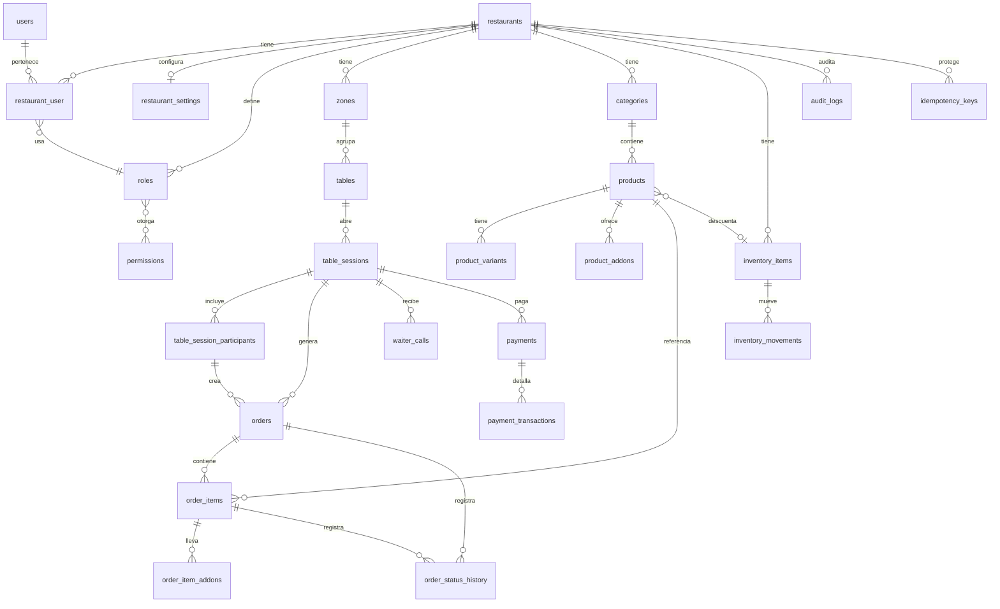

# Modelo de datos

Estado: Fase 1 (borrador). PostgreSQL 17. IDs internos `bigint`; identificador público `ulid` (columna `public_id`, único) — nunca se exponen los internos.

Esquemas PostgreSQL por contexto (`platform`, `catalog`, `ordering`, `billing`, `inventory`, `reporting`, ver ADR-007): las FK existen **dentro** de un esquema; entre esquemas solo se guarda la referencia (`restaurant_id`, `table_id`, `product_id`… como `bigint` indexado, o `public_id`) sin FK. El diagrama de abajo muestra relaciones lógicas.

Convenciones: `restaurant_id` NOT NULL en toda tabla de negocio con FK a `restaurants`; importes `bigint` en unidad mínima; timestamps `timestamptz` en UTC; enums como `varchar` + `CHECK`; soft deletes solo donde se indique. Relaciones entre tablas de negocio con FK compuesta `(restaurant_id, id)` (requiere `UNIQUE (restaurant_id, id)` en la tabla padre).

## Diagrama

## Tablas

### Plataforma / identidad

**restaurants**: `id`, `public_id`, `name`, `slug` (único), `legal_name`, `address`, `phone`, `email`, `logo_path`, `currency` (ISO 4217, char 3), `timezone`, `opening_hours` (jsonb), `status` (active|suspended|closed), `timestamps`, `deleted_at`.

**restaurant_settings**: `restaurant_id` (PK/FK 1:1), `auto_accept_orders` bool, `require_waiter_approval_for_session` bool, `prices_include_tax` bool, `default_tax_bps` int, `join_code_reuse_cooldown_minutes` int, `order_alert_threshold_seconds` int, `preferences` jsonb (preferencias visuales, impresión).

**users**: `id`, `public_id`, `name`, `email` (único), `password` (Argon2id), `email_verified_at`, `is_platform_admin` bool, `is_active` bool, `mfa_secret` (cifrado, nullable), `mfa_confirmed_at`, `remember_token`, `timestamps`. Sin `restaurant_id`: un usuario puede estar en varios.

**restaurant_user**: `restaurant_id`, `user_id`, `role_id`, `is_active`, `timestamps`. PK `(restaurant_id, user_id)`. FK `role_id` → roles con comprobación de que el rol es de sistema o del mismo restaurante.

**roles**: `id`, `restaurant_id` NULL (= rol de sistema), `key`, `name`, `is_system`. Único `(restaurant_id, key)`. Roles iniciales de sistema: waiter, kitchen, bar, restaurant_admin. (El "cliente" no es rol de usuario: es participante de sesión.)

**permissions**: `id`, `key` (p. ej. `orders.accept`), `description`. **permission_role**: `(role_id, permission_id)`.

### Salón

**zones**: `id`, `public_id`, `restaurant_id`, `name`, `sort_order`, `is_active`.

**tables**: `id`, `public_id`, `restaurant_id`, `zone_id`, `label`, `capacity`, `qr_token` (único global, 43 chars base64url), `qr_rotated_at`, `is_active`. Único `(restaurant_id, label)`.

**table_sessions**: `id`, `public_id`, `restaurant_id`, `table_id`, `status` (pending_approval|open|bill_requested|closed|expired), `join_code` (char 6, nullable al cerrar), `join_code_expires_at`, `opened_at`, `closed_at`, `closed_by`, `close_reason`, `approved_by`, `version`. **Índice único parcial** `(restaurant_id, join_code) WHERE status IN ('pending_approval','open','bill_requested')`; único parcial `(table_id) WHERE status IN (…)` = una sesión abierta por mesa. Tabla `join_code_cooldowns` evitada: la reutilización se controla consultando `closed_at` + `join_code_reuse_cooldown_minutes` (sin tabla extra).

**table_session_participants**: `id`, `public_id`, `restaurant_id`, `table_session_id`, `display_name`, `token_hash` (SHA-256 de la credencial), `join_token_hash` + `join_token_used_at` (token de un solo uso), `last_seen_at`, `revoked_at`.

### Menú

**categories**: `id`, `public_id`, `restaurant_id`, `name`, `description`, `sort_order`, `is_active`.

**products**: `id`, `public_id`, `restaurant_id`, `category_id`, `name`, `description`, `image_path`, `price` bigint, `tax_bps` int NULL (NULL = el del restaurante), `destination` varchar (kitchen|bar|… configurable; ver ADR), `allergens` jsonb, `ingredients` jsonb, `available_from/until` (horario), `is_available` bool, `is_sold_out` bool, `sort_order`, `deleted_at`.

**product_variants**: `id`, `restaurant_id`, `product_id`, `name`, `price_delta` bigint, `is_default`, `is_available`.

**product_addons**: `id`, `restaurant_id`, `product_id`, `name`, `price` bigint, `max_quantity`, `is_available`.

> Menús especiales y menú del día: se modelan en Fase 3 como un producto de tipo compuesto o como `menus` + `menu_items`; no se crean tablas ahora (ADR pendiente).

### Pedidos

**orders**: `id`, `public_id`, `restaurant_id`, `table_session_id`, `participant_id` NULL (NULL si lo registra personal), `created_by_user_id` NULL, `status` (pending|accepted|rejected|cancelled), `notes`, `currency`, `subtotal`, `tax_total`, `discount_total`, `total` (bigint), `accepted_at`, `accepted_by`, `rejected_at`, `rejected_by`, `reject_reason`, `cancelled_at`, `cancelled_by`, `cancel_reason`, `version`, `created_at`, `updated_at`. Índices: `(restaurant_id, status, created_at)`, `(restaurant_id, table_session_id)`.

**order_items**: `id`, `public_id`, `restaurant_id`, `order_id`, `product_id`, `participant_id`, `name_snapshot`, `variant_name_snapshot`, `unit_price`, `tax_bps`, `quantity`, `line_total`, `destination`, `status` (queued|preparing|ready|delivered|cancelled), `notes`, `queued_at`, `preparing_at`, `ready_at`, `delivered_at`, `cancelled_at` y `*_by` por cada uno, `cancel_reason`, `version`. Índice `(restaurant_id, destination, status)`.

**order_item_addons**: `id`, `restaurant_id`, `order_item_id`, `addon_id`, `name_snapshot`, `unit_price`, `quantity`.

**order_status_history**: `id`, `restaurant_id`, `order_id`, `order_item_id` NULL, `from_status`, `to_status`, `actor_user_id` NULL, `actor_participant_id` NULL, `reason`, `created_at`. Solo inserción.

**idempotency_keys**: `id`, `restaurant_id` NULL, `scope` (order|payment), `key`, `request_hash`, `response_status`, `response_body` jsonb, `locked_until`, `created_at`, `expires_at`. Único `(scope, key, actor)`.

### Servicio y pagos

**waiter_calls**: `id`, `public_id`, `restaurant_id`, `table_session_id`, `participant_id`, `kind` (assistance|bill|service), `note`, `status` (open|assigned|resolved), `assigned_to`, `resolved_by`, `created_at`, `assigned_at`, `resolved_at`. Las solicitudes de cuenta usan `kind = bill`.

**payments**: `id`, `public_id`, `restaurant_id`, `table_session_id`, `participant_id` NULL, `split_mode` (equal|by_participant|by_items|custom_amount), `amount`, `tip_amount`, `currency`, `status` (pending|succeeded|failed|refunded), `idempotency_key_id`, `created_by`, `timestamps`. Los artículos cubiertos por un pago se relacionan mediante `payment_items` (`payment_id`, `order_item_id`, `amount`) — tabla añadida porque "por artículos" lo necesita; se detalla en Fase 6.

**payment_transactions**: `id`, `restaurant_id`, `payment_id`, `gateway`, `gateway_reference`, `external_event_id` (único por pasarela, deduplica webhooks), `type` (authorize|capture|refund), `amount`, `status`, `payload` jsonb (sin datos de tarjeta), `created_at`.

### Inventario

**inventory_items**: `id`, `public_id`, `restaurant_id`, `product_id` NULL, `name`, `unit`, `quantity` numeric(14,3), `min_quantity`, `deducts_on` (order_accepted|item_delivered|manual), `is_active`. Preparado para recetas/proveedores sin tablas aún.

**inventory_movements**: `id`, `restaurant_id`, `inventory_item_id`, `type` (in|out|adjust|sale), `quantity`, `balance_after`, `reason`, `order_item_id` NULL, `user_id`, `created_at`. Solo inserción.

### Auditoría

**audit_logs**: `id`, `restaurant_id` NULL, `actor_user_id` NULL, `actor_participant_id` NULL, `action`, `subject_type`, `subject_id`, `old_values` jsonb, `new_values` jsonb (filtrados: nunca contraseñas/tokens), `ip`, `user_agent`, `created_at`. Solo inserción (permisos de BD sin UPDATE/DELETE para el rol de la app, como medida de protección).

## Restricciones transversales

- `CHECK (total = subtotal + tax_total - discount_total)` y `CHECK (importes >= 0)` en `orders`, `order_items`, `payments`.
- Una sola sesión abierta por mesa (índice parcial).
- FK compuestas que impiden relacionar entidades de restaurantes distintos.
- Transiciones de estado validadas en dominio; la BD solo restringe valores (`CHECK`).
- Aplicación conecta con un rol sin privilegios de DDL.

## Pendientes de justificar en fases posteriores

`payment_items`, tablas de agregados de informes, menús especiales / menú del día, destinos operativos configurables (hoy `destination` es `varchar`; si el restaurante define destinos propios se promueve a tabla `destinations`).
